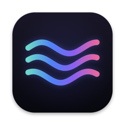

# zapret for macOS

**YouTube, Discord and Telegram working normally on a Mac — in one app.** 
A macOS counterpart of [zapret-discord-youtube by Flowseal](https://github.com/Flowseal/zapret-discord-youtube).

### [Download zapret.dmg](https://github.com/slow-ball/zapret-discord-youtube-macos/releases/latest)

[Русский](README.md) · English

The app speaks the language of your Mac: English or Russian.

## What it does

- **One switch** — in the menu bar, a widget or the ⌃⌥Z hot key.
- **Finds what works by itself**, usually in seconds. 37 strategies: 22 from the Windows version and 15 of its
  own for macOS. The ones that worked before go first; YouTube, Discord and Discord voice are checked.
- **Repairs and updates itself.** If the provider changes something, the strategy changes by itself.
  Fresh strategies of the Windows version arrive automatically.
- **Telegram in one click.** A built-in proxy for Telegram Desktop.
- **A site doesn't open?** Enter its address — zapret finds a way for it and checks it the way a browser does.
- **If nothing helped** — deep search: hundreds of options for one site; the one it finds works for that site.
- **Leaves the rest of the internet alone.** Banks, government services, marketplaces and other sites that
  only suffer from it are excluded. Smart mode touches only what really doesn't open.
- **Diagnostics with Fix buttons**: VPN, DNS spoofing, system proxy, browser settings.
- **Games**, like Game Filter in the Windows version.
- **Careful updates.** Only published, signed releases; What's New after an update and going back with one click.
  After a macOS update zapret checks that everything is in place.

## Install

1. Download **[zapret.dmg](https://github.com/slow-ball/zapret-discord-youtube-macos/releases/latest)**, open it
   and drag **zapret** into Applications.
2. Open zapret. macOS says it can't verify the app — click **Done**, then
   **System Settings → Privacy & Security → Open Anyway**. Once: an anonymous project has no paid Apple signature.
3. Click **Install** and enter your Mac password. A minute later everything works.
4. Quit the browser completely (Cmd+Q) and open it again.

With [Homebrew](https://brew.sh): `brew install --cask slow-ball/tap/zapret`, then open zapret and click Install.

## How it works

Inside is one engine — nfqws of [zapret](https://github.com/bol-van/zapret) in Flowseal's macOS port, built in
this project. The macOS firewall sends the traffic of apps (not of system services, not of a VPN) to the engine,
which splits packets and adds fake ones so the provider can't recognise the site. It handles QUIC and Discord
voice (UDP) too, and IPv6 when the check at start passes.

**Telegram.** [tg-ws-proxy by Flowseal](https://github.com/Flowseal/tg-ws-proxy): Telegram Desktop connects to a
local proxy, which passes the traffic over WebSocket to Telegram's web servers. The data stays encrypted, no
third-party servers. The proxy runs as the user nobody, without admin rights.

**Security.** Everything downloaded at install is checked against checksums: the nfqws engine, the app, the
proxy's dependencies. The engine and the app are built by GitHub Actions from the sources of this repository.
Updates come only from published releases and are signed with a key that isn't on GitHub: without a valid
signature zapret installs no update. The password is needed because zapret changes the macOS firewall rules;
afterwards the app controls zapret without a password only through a fixed set of commands
(`/etc/sudoers.d/zapret-macos`).

## If it doesn't work

1. **Turn off the VPN.** While it runs, traffic goes through it and zapret isn't involved.
2. **Restart the browser** (Cmd+Q).
3. **Find a strategy** — Strategies → Find; if that didn't help — Check all 37.
4. **Checkup** — click Fix next to the problems.
5. **Deep search** — Strategies → Nothing helped?, 5–15 minutes.
6. Still nothing — Checkup → **Report a problem**: a GitHub form opens with a ready report
   (no IP addresses, names or paths).

## Removal

In the app: **Settings → Remove…**. Without the app: `sudo ~/zapret-macos/src/zapret.sh uninstall`.

## Thanks

- [bol-van/zapret](https://github.com/bol-van/zapret) — zapret and nfqws
- [Flowseal/zapret-discord-youtube](https://github.com/Flowseal/zapret-discord-youtube) — strategies, the idea and the format
- [Flowseal/zapret-mac-discord-youtube](https://github.com/Flowseal/zapret-mac-discord-youtube) — the nfqws port for macOS (MIT, `src/nfqws/LICENSE`)
- [Flowseal/tg-ws-proxy](https://github.com/Flowseal/tg-ws-proxy) — the Telegram proxy (MIT)
