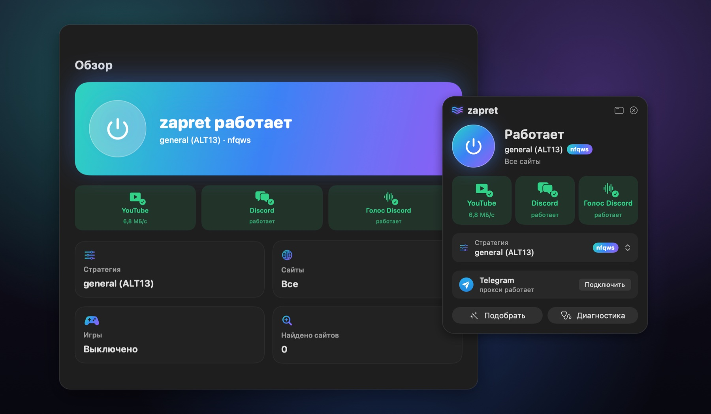
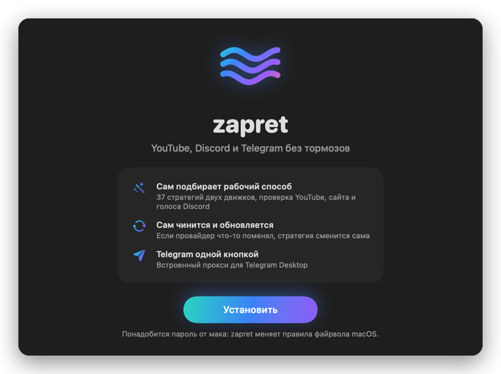
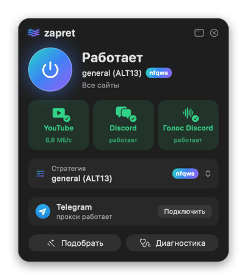
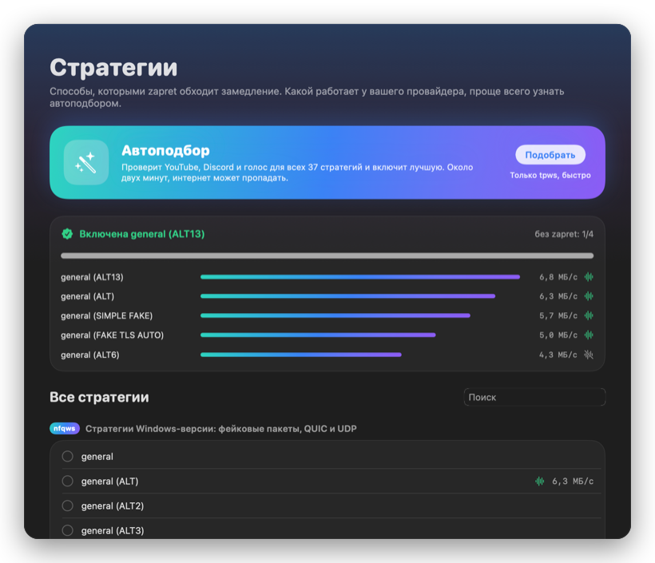
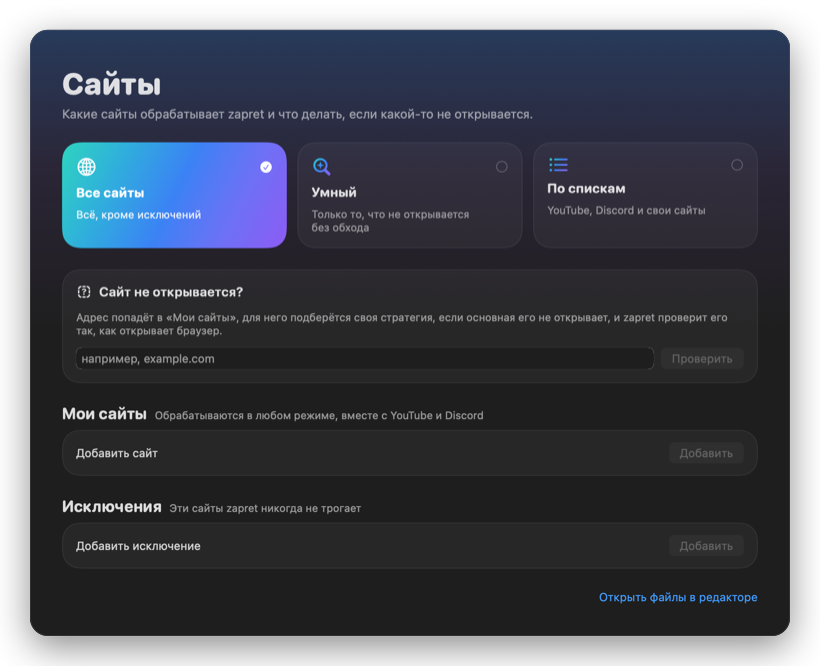
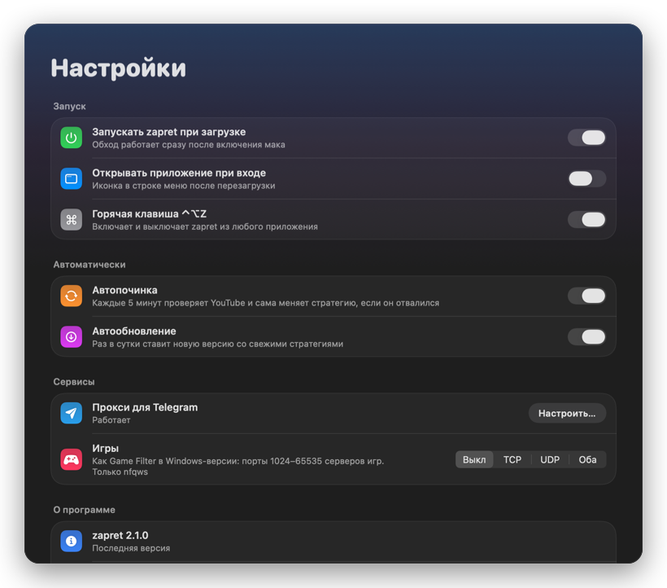

<div align="center">


# zapret для macOS

**Нормальная работа YouTube, Discord и Telegram на маке — в одном приложении.**<br>
Аналог [zapret-discord-youtube от Flowseal](https://github.com/Flowseal/zapret-discord-youtube) для macOS.

[](https://github.com/slow-ball/zapret-discord-youtube-macos/releases/latest)
[](https://github.com/slow-ball/zapret-discord-youtube-macos/actions/workflows/check.yml)

[](LICENSE)

### [Скачать zapret.dmg](https://github.com/slow-ball/zapret-discord-youtube-macos/releases/latest)

Русский · [English](README.en.md)

</div>

<p align="center"></p>

## Что умеет

- **Включается одной кнопкой** — из строки меню, виджета или горячей клавишей ⌃⌥Z.
- **Сам подбирает рабочий способ** — обычно за секунды. 37 стратегий: 22 из Windows-версии и 15 своих
  для macOS. Сначала проверяются те, что работали раньше; проверяются YouTube, Discord и голос в Discord.
- **Сам чинится и обновляется.** Если провайдер что-то поменял — стратегия сменится сама и придёт
  уведомление. Свежие стратегии Windows-версии приезжают автоматически.
- **Telegram одной кнопкой.** Встроенный прокси для Telegram Desktop: «Подключить» — и Telegram сам его добавит.
- **Сайт не открывается?** Ввести адрес — zapret подберёт для него способ и проверит, как браузер.
- **Если ничего не помогло** — глубокий подбор: сотни вариантов для одного сайта, найденный работает для него.
- **Не ломает остальной интернет.** Банки, Госуслуги, маркетплейсы и другие сайты, которым обход только мешает,
  в исключениях. Умный режим трогает только то, что действительно не открывается.
- **Диагностика с кнопками «Исправить»**: VPN, подмена DNS, системный прокси, настройки браузеров.
- **Игры**, как Game Filter в Windows-версии.
- **Обновляется аккуратно.** Только опубликованные версии, «Что нового» после обновления и возврат
  предыдущей версии одной кнопкой. После обновления macOS zapret сам проверяет, что всё на месте.

## Установка

1. Скачать **[zapret.dmg](https://github.com/slow-ball/zapret-discord-youtube-macos/releases/latest)**, открыть
   и перетащить **zapret** в «Программы».
2. Открыть zapret. macOS скажет, что не может проверить приложение, — нажать **«Готово»**, затем
   **Системные настройки → Конфиденциальность и безопасность → «Всё равно открыть»**. Это нужно один раз:
   у анонимного проекта нет платной подписи Apple.
3. Нажать **«Установить»** и ввести пароль от мака. Через минуту всё работает.
4. Полностью закрыть браузер (Cmd+Q) и открыть заново.

<p align="center"></p>

Через [Homebrew](https://brew.sh): `brew install --cask slow-ball/tap/zapret`, затем открыть zapret и нажать «Установить».

<details>
<summary>Установка через Терминал</summary>

```bash
mkdir -p ~/zapret-macos && curl -fsSL https://github.com/slow-ball/zapret-discord-youtube-macos/archive/refs/heads/main.tar.gz | tar xz --strip-components=1 -C ~/zapret-macos && ~/zapret-macos/zapret.command
```

Ввести пароль от мака (символы при вводе не видны, это нормально). После установки откроется приложение.
</details>

## Приложение

<table>
<tr>
<td width="50%"></td>
<td width="50%"></td>
</tr>
<tr>
<td><b>Строка меню.</b> Кнопка включения, проверка YouTube, Discord и голоса, выбор стратегии,
Telegram одной кнопкой.</td>
<td><b>Стратегии.</b> Автоподбор вживую: скорость и голос для каждой стратегии, лучшая включается сама.</td>
</tr>
<tr>
<td></td>
<td></td>
</tr>
<tr>
<td><b>Сайты.</b> Режимы, «Сайт не открывается?», свои списки и исключения.</td>
<td><b>Настройки.</b> Запуск, автопочинка и автообновление, прокси для Telegram, игры.</td>
</tr>
</table>

А ещё:

- **Виджет** для рабочего стола: состояние и кнопки «Включить/Выключить», «Подобрать»
  (правый клик по рабочему столу → «Изменить виджеты» → zapret).
- **Уведомления с кнопками**: zapret остановился — «Включить», YouTube перестал открываться — «Подобрать стратегию»,
  вышло обновление — «Обновить».
- **Горячая клавиша ⌃⌥Z** — включить или выключить из любого приложения; в окне ⌘1…⌘6 — разделы, ⌘R — проверить заново.
- **Журнал**: что делал zapret, его движок и прокси для Telegram, с поиском.
- **Главная**: состояние и сервисы — YouTube, Discord и Telegram с кнопками «Открыть» и «Подключить».
- **Светлая и тёмная тема**, Intel и Apple Silicon.

## Как это работает

Внутри один движок — nfqws из [zapret](https://github.com/bol-van/zapret) в маковском порте Flowseal,
собранный в этом проекте. Трафик программ (не системных служб и не VPN) файрвол macOS заворачивает
в движок, а тот дробит пакеты и добавляет фейковые, чтобы провайдер не узнал сайт. QUIC и голос Discord
(UDP) он обрабатывает тоже, IPv6 — если проверка при запуске прошла.

| | Windows-версия | macOS |
|---|---|---|
| Стратегии | 22, из [zapret-discord-youtube](https://github.com/Flowseal/zapret-discord-youtube) | 15 своих: разбиение пакетов и фейки |
| Откуда | переносятся автоматически, как только выходит новая версия | `src/nfqws/macos.conf` |
| В автоподборе | в приоритете | если заметно быстрее |

Каждый день GitHub Actions проверяет, не вышла ли новая Windows-версия, переносит стратегии и проверяет их.
Глубокий подбор находит для сайта свой вариант и включает его только для этого сайта.

**Режимы сайтов** (раздел «Сайты»):
- **Все** (по умолчанию) — обрабатываются все сайты, кроме исключений.
- **Умный** — YouTube, Discord, свои сайты и те, что дважды подряд не открылись без обхода. Остальное не трогается.
- **По спискам** — только YouTube, Discord и свои сайты.

**Telegram.** [tg-ws-proxy от Flowseal](https://github.com/Flowseal/tg-ws-proxy): Telegram Desktop подключается
к локальному прокси, а тот передаёт трафик через WebSocket на веб-серверы Telegram. Данные остаются
зашифрованными, сторонние серверы не нужны. Трафик прокси идёт через zapret, поэтому он работает и там, где
отдельный прокси на маке не подключается. Прокси работает от пользователя nobody, без прав администратора.

**Безопасность.** Всё, что скачивается при установке, проверяется по контрольным суммам: движок nfqws,
приложение, зависимости прокси. Движок и приложение собираются в GitHub Actions из исходников этого
репозитория. Обновления приходят только из опубликованных релизов и подписаны ключом, которого нет на GitHub:
без верной подписи zapret обновление не поставит. Пароль нужен, потому что zapret меняет правила файрвола macOS; приложение
потом управляет zapret без пароля только через фиксированный набор команд (`/etc/sudoers.d/zapret-macos`).

## Если не работает

1. **Выключить VPN.** Пока он работает, трафик идёт через него и zapret не участвует.
2. **Перезапустить браузер** (Cmd+Q).
3. **Подобрать стратегию** — «Стратегии» → «Подобрать»; если не помогло — «Проверить все 37».
4. **Проверка** — нажать «Исправить» у пунктов с ошибками.
5. **Глубокий подбор** — «Стратегии» → «Ничего не помогло?», 5–15 минут.
6. Если не помогло — «Проверка» → **«Сообщить о проблеме»**: откроется форма на GitHub с готовым отчётом
   (без IP-адресов, имён и путей).

## FAQ

<details>
<summary>Можно одновременно с VPN?</summary>

Можно, они не мешают друг другу. Пока VPN включён, трафик идёт через него.
</details>

<details>
<summary>Почему macOS не даёт открыть приложение?</summary>

Apple требует платную подпись разработчика с именем и документами, а проект анонимный. Приложение подписано
без сертификата, его сборка открыта в GitHub Actions. Разрешить открытие нужно один раз:
Системные настройки → Конфиденциальность и безопасность → «Всё равно открыть».
</details>

<details>
<summary>На маке уже стоит zapret от bol-van. Что будет?</summary>

zapret-macos его не использует и не трогает: у него свой движок в `/opt/zapret-macos`. Два обхода сразу
мешают друг другу, поэтому службу своего zapret лучше выключить.
</details>

<details>
<summary>Что и куда ставится?</summary>

- `/Applications/zapret.app` — приложение;
- `~/zapret-macos` — проект: скрипты, стратегии, свои списки (`lists/list-user.txt`, `lists/list-exclude-user.txt`);
- `/opt/zapret-macos` — служебная копия скриптов, движок nfqws, прокси для Telegram;
- службы launchd в `/Library/LaunchDaemons` (`zapret`, `com.zapret-macos.*`).
</details>

<details>
<summary>Для продвинутых: Терминал и команды</summary>

Меню: `~/zapret-macos/zapret.command`.

```
  1) Запустить / сменить стратегию
  2) Остановить
  3) Подобрать стратегию автоматически
  4) Диагностика
  5) Автозапуск при загрузке: вкл/выкл
  6) Автопочинка (сама меняет стратегию, если YouTube отвалился): вкл/выкл
  7) Приложение zapret (иконка в строке меню): установить или обновить
  8) Сайты: все / умный / только YouTube, Discord и свои списки
  9) Списки доменов и найденные сайты
 10) Обновить
 11) Вернуть предыдущую версию
 12) Удалить zapret
 13) Игровой фильтр
 14) Автообновление (раз в сутки): вкл/выкл
 15) Прокси для Telegram
```

Все команды: `~/zapret-macos/src/zapret.sh help`. Например, `check --quick` — подбор только среди стратегий Windows-версии,
`site <адрес>` — сайт не открывается, `telegram test` — проверка пути до Telegram, `dns` — DNS 1.1.1.1.

Сборка: `build/app.sh` — приложение и `zapret.dmg`, `build/utunws.sh` — движок nfqws,
`build/import-windows.py` — перенос стратегий из Windows-версии (нужны Command Line Tools).
</details>

## Удаление

В приложении: **Настройки → «Удалить…»**. zapret останавливается, службы, правила файрвола и движки убираются;
вариант «и приложение» отправляет в Корзину ещё приложение и папку `~/zapret-macos`.
Без приложения — `sudo ~/zapret-macos/src/zapret.sh uninstall` (или пункт 12 меню Терминала).

## Благодарности

- [bol-van/zapret](https://github.com/bol-van/zapret) — zapret и nfqws
- [Flowseal/zapret-discord-youtube](https://github.com/Flowseal/zapret-discord-youtube) — стратегии, идея и формат
- [Flowseal/zapret-mac-discord-youtube](https://github.com/Flowseal/zapret-mac-discord-youtube) — порт nfqws на macOS (MIT, `src/nfqws/LICENSE`)
- [Flowseal/tg-ws-proxy](https://github.com/Flowseal/tg-ws-proxy) — прокси для Telegram (MIT)
