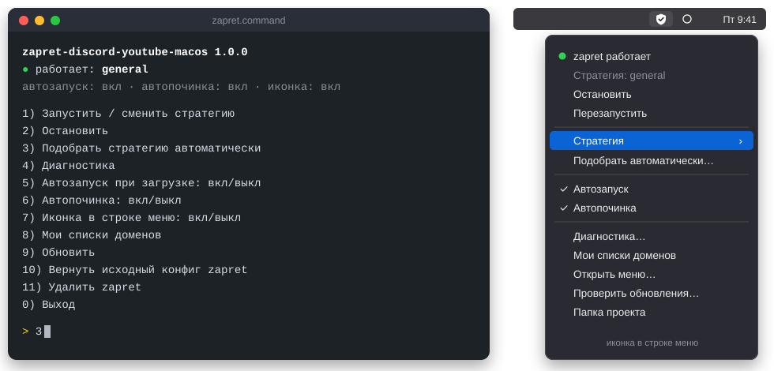

<div align="center">

# zapret-discord-youtube-macos

**Нормальная работа YouTube и Discord на macOS. Аналог [zapret-discord-youtube от Flowseal](https://github.com/Flowseal/zapret-discord-youtube) для мака.**

[](https://github.com/slow-ball/zapret-discord-youtube-macos/releases/latest)
[](https://github.com/slow-ball/zapret-discord-youtube-macos/actions/workflows/check.yml)

[](LICENSE)

</div>

Один файл: при первом запуске он всё устанавливает, дальше открывает меню управления.
Внутри используется [zapret от bol-van](https://github.com/bol-van/zapret): установщик скачивает
официальный релиз и проверяет его контрольную сумму.

<p align="center"></p>

## Возможности

- **Установка одной командой** или одним файлом из архива.
- **Приложение для macOS**: иконка в строке меню с большой кнопкой включения и окно со всеми настройками. SwiftUI, светлая и тёмная тема, виджет, уведомления с кнопками, горячая клавиша ⌃⌥Z.
- **Меню управления в Терминале**: то же самое без приложения.
- **Два движка**: tpws от bol-van и nfqws с фейковыми пакетами, как в Windows-версии (порт от Flowseal). 37 стратегий.
- **Свежие стратегии**: новые стратегии Windows-версии переносятся автоматически, автообновление ставит их само.
- **Автоподбор стратегии**: проверяются стратегии обоих движков, YouTube, Discord и голос в Discord, включается лучшая.
- **Автопочинка**: раз в 5 минут проверяется YouTube. Если что-то перестало работать, стратегия подбирается заново и приходит уведомление.
- **Диагностика**: включённый VPN, конфликтующие программы, подмена DNS, системный прокси, правила файрвола.
- **Свои списки доменов**, которые не теряются при обновлении.
- **Умный режим**: zapret сам замечает сайты, которые не открываются, и начинает их обрабатывать. Остальные сайты не трогает.
- **Своя стратегия для каждого сайта**: если основная стратегия какой-то сайт не открывает, для него подбирается другая.
- **Режимы сайтов**: все, умный или только YouTube, Discord и свои списки.
- **Игровой фильтр**, как Game Filter в Windows-версии.
- **Прокси для Telegram Desktop**: локальный, подключается одной кнопкой.
- **Обновление из меню**, уведомления macOS, Intel и Apple Silicon.

## Установка

### Приложение (рекомендуется)

1. Скачать **zapret.dmg** со [страницы релизов](https://github.com/slow-ball/zapret-discord-youtube-macos/releases/latest).
2. Открыть его и перетащить **zapret** в «Программы».
3. Открыть zapret. macOS скажет, что не может проверить приложение — нажать **«Готово»**, затем
   **Системные настройки → Конфиденциальность и безопасность → «Всё равно открыть»** (один раз).
4. Нажать **«Установить»** и ввести пароль от мака. Через минуту всё работает.

### Через Терминал

1. Открыть **Терминал**: Cmd+Пробел → «Терминал».
2. Вставить команду и нажать Enter:

```bash
mkdir -p ~/zapret-macos && curl -fsSL https://github.com/slow-ball/zapret-discord-youtube-macos/archive/refs/heads/main.tar.gz | tar xz --strip-components=1 -C ~/zapret-macos && ~/zapret-macos/zapret.command
```

3. Ввести пароль от мака. При вводе символы не отображаются, это нормально.
4. После установки откроется приложение и меню в Терминале. Полностью закрыть браузер (Cmd+Q) и открыть заново.

Проект будет в папке `zapret-macos` в домашней папке (Finder → Cmd+Shift+H).

### Через архив

1. Скачать архив: **Code → Download ZIP**, распаковать.
2. Дважды кликнуть по `zapret.command`. macOS покажет, что не может проверить файл, нажать **«Готово»**.
3. Открыть **Системные настройки → Конфиденциальность и безопасность**, прокрутить вниз до раздела «Безопасность».
   Там будет строка про `zapret.command`, нажать **«Всё равно открыть»** и подтвердить паролем или Touch ID.
4. Снова дважды кликнуть по `zapret.command` и нажать **«Открыть»**.

Разрешение нужно дать один раз, остальные файлы проекта установщик разблокирует сам.

<details>
<summary>Если кнопки «Всё равно открыть» нет</summary>

Открыть Терминал, набрать `bash ` (с пробелом в конце), перетащить в окно файл `zapret.command` и нажать Enter.
</details>

## Использование

Для управления запускается тот же `zapret.command`:

```
zapret-discord-youtube-macos 2.0.0
● работает: general
  сайты: все · автозапуск: вкл · автопочинка: выкл · иконка: выкл

  1) Запустить / сменить стратегию
  2) Остановить
  3) Подобрать стратегию автоматически
  4) Диагностика
  5) Автозапуск при загрузке: вкл/выкл
  6) Автопочинка: вкл/выкл
  7) Иконка в строке меню: вкл/выкл
  8) Сайты: все / умный / только YouTube, Discord и свои списки
  9) Списки доменов и найденные сайты
 10) Обновить
 11) Вернуть исходный конфиг zapret
 12) Удалить zapret
```

Выбранная стратегия запоминается, и после перезагрузки zapret стартует с ней.

### Движки

| | tpws | nfqws |
|---|---|---|
| Откуда | [zapret от bol-van](https://github.com/bol-van/zapret) | [порт от Flowseal](https://github.com/Flowseal/zapret-mac-discord-youtube) |
| Как работает | прозрачный TCP-прокси, дробит TLS (split, disorder, tlsrec, oob) | перехватывает пакеты через utun, добавляет фейковые пакеты |
| Стратегии | 15 | 22, из Windows-версии 1.10.4 |
| QUIC / HTTP3 | отключается, браузер переходит на TCP | обходится фейками |
| Голос Discord (UDP) | не обрабатывается | обрабатывается |
| IPv6 | ✓ | ✓, если проверка при запуске прошла; иначе сайты по IPv6 открываются через IPv4 |

Стратегии nfqws в списке начинаются с `nfqws`. Движок скачивается при первом выборе такой стратегии
с проверкой контрольной суммы. Как он собирается — `build/utunws.sh`.

Стратегии nfqws переносятся из [Windows-версии](https://github.com/Flowseal/zapret-discord-youtube)
скриптом `build/import-windows.py` и обновляются вместе с ней.

Автоподбор сначала параллельно проверяет tpws за несколько секунд, затем по очереди nfqws, около двух минут.
На время проверки nfqws интернет может пропадать. Чтобы проверить только tpws:
`sudo ~/zapret-macos/src/zapret.sh check --quick`.

### Иконка в строке меню

Пункт меню **7**. Будет установлен бесплатный [SwiftBar](https://swiftbar.app), и возле часов появится щит:
с галочкой — работает, перечёркнутый — остановлен. Из иконки можно менять стратегию, включать
автозапуск и автопочинку и открывать диагностику.

### Приложение

Ставится при установке, позже — пунктом меню **7** (`zapret.sh app`).

- Открытое вручную приложение показывает окно; при входе в систему — только иконку в строке меню.
- **Иконка в строке меню**: кнопка включения, проверка YouTube, Discord и голоса, выбор стратегии, автоподбор,
  прокси для Telegram одной кнопкой «Подключить».
- **Окно**: стратегии с живым автоподбором, режимы сайтов и найденные сайты, игровой фильтр, Telegram, диагностика, настройки.
- **Виджет** для рабочего стола и Центра уведомлений: состояние, кнопки «Включить/Выключить» и «Подобрать»
  (правый клик по рабочему столу → «Изменить виджеты» → zapret).
- **Уведомления с кнопками**: zapret остановился — «Включить», YouTube перестал открываться — «Подобрать стратегию»,
  вышло обновление — «Обновить»; автопочинка сменила стратегию.
- **Горячая клавиша ⌃⌥Z** включает и выключает zapret из любого приложения (отключается в настройках).
- Ссылки `zapret://toggle`, `zapret://start`, `zapret://stop`, `zapret://check` — для Shortcuts и автоматизаций.
- **Сайт не открывается?** В разделе «Сайты»: адрес попадает в свой список, для него подбирается своя стратегия,
  zapret проверяет его как браузер (`zapret.sh site <адрес>`). Там же — свои списки и исключения.
- **Диагностика с кнопками**: перезапустить, подобрать стратегию, поставить DNS 1.1.1.1 (`zapret.sh dns`),
  открыть нужные настройки сети, Chrome или iCloud.
- Приложение обновляется вместе с проектом.

Приложение управляет zapret без пароля: при установке zapret разрешает администраторам мака запускать
свои команды (`/etc/sudoers.d/zapret-macos`). Обновление спрашивает пароль.
Собрать самому: `build/app.sh` (нужны Command Line Tools), приложение — в `dist/zapret.app`.

### Игровой фильтр

Пункт меню **13**, в приложении — раздел «Игры». Как Game Filter в Windows-версии: обход работает
и для портов 1024–65535 серверов игр и облаков (TCP, UDP или оба). Только с движком nfqws.

### Telegram

Пункт меню **15**, в приложении — раздел «Telegram». Локальный MTProto-прокси
([tg-ws-proxy от Flowseal](https://github.com/Flowseal/tg-ws-proxy)): Telegram Desktop подключается
к нему, а он передаёт трафик через WebSocket на веб-серверы Telegram. Кнопка «Подключить Telegram»
добавляет прокси в Telegram одним кликом, ссылка также есть в `zapret.sh telegram link`.
«Проверить связь» (`zapret.sh telegram test`) проходит весь путь: рукопожатие как у Telegram через прокси
и ответ сервера Telegram. Трафик прокси идёт через zapret, поэтому работает и там, где отдельный
TG WS Proxy на маке не подключается. Если порт 1443 занят, прокси берёт следующий свободный.
Нужен Python из Command Line Tools (`xcode-select --install`); зависимости ставятся в отдельное
окружение с проверкой хешей. Прокси работает от пользователя nobody.

### Обновления

Пункт меню **14** — автообновление: раз в сутки ставится новая версия и перезапускается текущая
стратегия. Стратегии nfqws переносятся из Windows-версии сами: каждый день GitHub Actions
проверяет, не вышла ли новая версия, переносит стратегии, проверяет их и готовит обновление.

### Режимы сайтов

Пункт меню **8**.

- **Все** (по умолчанию) — обрабатываются все сайты, кроме исключений.
- **Умный** — YouTube, Discord, свои списки и сайты, которые сами попали в список найденных:
  если сайт два раза подряд не открылся, zapret запоминает его и дальше обрабатывает.
  Нормальные сайты не трогаются, поэтому ничего не ломается.
- **По спискам** — только YouTube, Discord и свои списки.

Найденные сайты — пункт меню **9**. Там же подбор стратегий для них: для каждого сайта, который
основная стратегия не открывает, перебираются стратегии tpws, и подходящая включается только для него.
С автопочинкой это происходит само в фоне. Свои стратегии для сайтов работают с движком tpws.

### Свои домены

- `lists/list-user.txt` — дополнительные домены, по одному в строке, поддомены учитываются автоматически.
- `lists/list-exclude-user.txt` — домены, которые zapret не трогает.

После правки нужно перезапустить стратегию. Эти файлы не перезаписываются при обновлении.

По умолчанию zapret обрабатывает все сайты, поэтому `list-user.txt` нужен только в режиме «по спискам» (пункт меню **8**).
Исключения работают в обоих режимах.

## Если не работает

1. **Выключить VPN.** Пока он работает, трафик идёт через него и zapret не участвует.
2. **Перезапустить браузер** (Cmd+Q).
3. **Подобрать стратегию**: пункт меню 3, около двух минут.
4. **Запустить диагностику**: пункт меню 4, исправить пункты с ✗ и !.
5. В Chrome выключить «Безопасный DNS», в Safari выключить iCloud Private Relay.
6. Если не помогло — [создать Issue](https://github.com/slow-ball/zapret-discord-youtube-macos/issues/new/choose) с выводом подбора и диагностики.

## FAQ

<details>
<summary>Можно одновременно с VPN?</summary>

Можно, они не мешают друг другу. Но пока VPN включён, трафик идёт через него.
</details>

<details>
<summary>На маке уже стоит zapret. Что будет?</summary>

Установщик не переустанавливает zapret, а только меняет `config`. Исходный конфиг сохраняется,
вернуть его можно пунктом меню 11.
</details>

<details>
<summary>Зачем пароль?</summary>

zapret меняет правила файрвола macOS (pf), для этого нужны права администратора.
В Windows-версии запуск тоже идёт от имени администратора.
</details>

## Отличия от Windows-версии

На macOS нет WinDivert. Стратегии Windows-версии работают через nfqws (перехват через utun),
плюс есть свой набор для tpws.

| | Windows (Flowseal) | macOS (этот проект) |
|---|---|---|
| Движок | winws | nfqws (порт Flowseal) и tpws |
| Фейковые пакеты | ✓ | ✓ в nfqws |
| IPv6 | ✓ | ✓ в tpws |
| Автоподбор, автопочинка, иконка в меню | — | ✓ |

## Удаление

Пункт меню **12**: zapret останавливается, автозапуск, автопочинка, иконка и правила файрвола убираются,
`/opt/zapret` удаляется. После этого можно удалить папку проекта.

## Благодарности

- [bol-van/zapret](https://github.com/bol-van/zapret) — движок tpws
- [Flowseal/zapret-mac-discord-youtube](https://github.com/Flowseal/zapret-mac-discord-youtube) — порт nfqws на macOS и его стратегии (MIT, `src/nfqws/LICENSE`)
- [Flowseal/zapret-discord-youtube](https://github.com/Flowseal/zapret-discord-youtube) — идея и формат
- [Flowseal/tg-ws-proxy](https://github.com/Flowseal/tg-ws-proxy) — прокси для Telegram (MIT)
- [SwiftBar](https://github.com/swiftbar/SwiftBar) — иконка в строке меню
